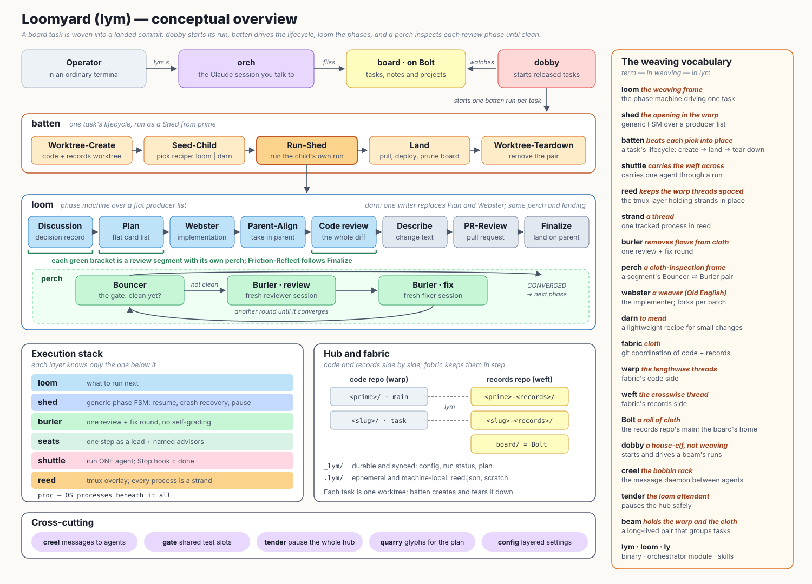

# LoomYard

LoomYard turns a to-do list into landed commits.
You write down what you want changed, and LoomYard has AI agents discuss it, plan it, implement it, review it and merge it into your project, many tasks at the same time, while you do other things.

It is built on [Claude Code](https://claude.ai/code), and its command-line tool is called **`lym`**.

LoomYard is developed by LoomYard.
This repository's own tasks run through its own pipeline, and every run's records are public in the companion repository [loomyard-weft](https://github.com/Knatte18/loomyard-weft) (see [The records of this repository](#the-records-of-this-repository)).

## The problem

Asking one AI session to do a big task works until it does not:
the session loses track of the plan, reviews its own work too kindly, and leaves half a change behind when it crashes.
Running several sessions at once adds a second problem, because they overwrite each other's files and nobody keeps the state of each.

LoomYard's answer is to put an ordinary program around the agents.
The program decides what happens next, keeps the state, runs git and checks every result.
Agents are asked only for the work that needs judgment, such as writing a plan or reviewing a diff, and each of them is handed a narrow job and must hand back named files that a mechanical check accepts.
An agent whose files fail the check is sent the findings in the same session, and does not get to move on.

The payoff is that a run is repeatable, a crashed run resumes where it stopped, and no agent grades its own work.

## The concepts, in the order you meet them

### Hub and worktrees

A **hub** is a directory that LoomYard creates for one project, and it holds everything LoomYard works with.
Inside it, each line of work lives in its own git **worktree**, a separate checkout of your repository, so two tasks never touch the same files.

Every worktree has a sibling that holds LoomYard's own files for it: configuration, plans, review verdicts and run status.
Those files live in a second git repository, the **records repository**, so your project's history and `.gitignore` stay free of LoomYard.
The two repositories branch together, which is why a task's whole state is versioned and a task can be picked up on another machine.

```
<hub>/
  ├── <project>/             your repository, on its main branch (the prime)
  ├── <project>-<records>/   its records sibling
  ├── <task>/                a task's worktree, on the task's branch
  ├── <task>-<records>/      its records sibling
  └── _bolt/                the task board
```

The first worktree, on your main branch, is the **prime**.
`lym fabric` is the command group that keeps the pairs of code and records in step; you rarely call it by hand after the first clone.

### The board and its tasks

The **board** is the hub's task list, kept in the records repository and rendered as a README there.
An entry is a **task**, a **note** or a **project**.
A task is work to do, and it can depend on other tasks.
A note is an idea that is not ready to be done, and you promote it to a task when it is.
A project groups entries, and a project can become a beam, described below.

A task carries a title, a body that says what is wanted, labels and a **recipe**.
The recipe names the kind of run the task gets:

- `darn`, the default, for a change that one writer can make, test and commit.
- `tapestry`, for a task big enough to need a discussion and a plan.

A task with no recipe runs the recipe `default_recipe` names in the hub's `board.yaml`, which is `darn` unless the hub changed it.

A new task is a draft, and nothing starts it until you release it.

```bash
lym board upsert '{"slug":"fix-login","title":"Fix the login redirect","brief":"Redirect loops after logout","kind":"task","labels":["bug"]}'
lym board set-status '{"slug":"fix-login","status":null}'   # release the draft
```

`lym board --help` lists the other verbs, among them `list`, `find` and `promote`.

### Runs

A **run** is one task's walk from its board entry to a landed commit.
It is a fixed list of steps, each of them either plain Go code or one agent session, and the list is chosen by the task's recipe.
The list is data: [`contracts/recipes/`](contracts/recipes/) holds the recipe files, and a run records which step it is on after each one, so it can pause, crash and resume at a step boundary.

An agent is always an interactive Claude Code session in a tmux pane, never headless `claude -p`, which keeps your subscription coverage.
You can watch any of them:

```bash
lym reed attach    # or the shortcut: lym a
```

### Beams, dobby and orch

A hub's prime is also the first **beam**: a long-lived unit that the tasks under it fork from and land back into.
A project on the board can become a beam of its own with `lym beam create`, and its tasks then fork from the beam's branch and land into it; the beam lands into its parent when you flag it ready with `lym beam ready`.

Each beam has two long-lived helpers.

- **Dobby** is a background program, not an agent.
  It watches the board, and when a task is released and the tasks it depends on are done, it starts the task's run, and it keeps driving that run in short passes until the run finishes.
  Dobby is what makes "release a task" enough to get work started, and a setting in `beam.yaml` caps how many runs it drives at once.
- **Orch** is the Claude session you talk to.
  It knows the hub's rules, files board entries with you, reads what dobby and the runs report, and repairs or escalates what goes wrong.
  A watcher clears or compacts its context before the window fills, so it lasts across a working day.

`lym beam start` brings both up for the prime, and `lym s` is the shortcut that does that and then attaches to the tmux session.
Orch and the agents of a run talk to each other through `lym creel`, a small message service in the hub.

## From the board to a landed commit



When you release a task, this is what happens, with no step of it done by you:

1. **Dobby starts the run.**
   The run first makes the task's worktree pair and seeds the run with the task's recipe and settings.
   Everything after that happens inside that worktree, so other tasks cannot see it.
2. **Discussion** (tapestry recipe).
   An agent turns the board entry into a **decision record**: the scope, the decisions taken and what is out of scope.
   A darn run has its writer write the same record before it writes any code.
3. **Plan** (tapestry recipe).
   An agent writes a plan as a list of cards, each naming the code it touches by a symbol spelling that is looked up in the real tree, so a plan that names a function that does not exist fails before any code is written.
4. **Implementation.**
   In a tapestry run, the **Webster** step reads the plan once and forks one implementer per batch of cards, and Go code verifies and records each batch.
   In a darn run, the one writer edits, tests and commits.
5. **Review.**
   The decision record, the plan and the code are each reviewed in a **review segment**: a judge decides whether the artifact is clean, and if not, a fresh reviewer session and a fresh fixer session make another round, within a budget of rounds.
   The agents that review and fix are never the one that wrote the artifact, and an exhausted budget halts the run for a human instead of looping.
6. **Landing.**
   The run merges the parent branch into the task, a **Describe** step writes the change description, and the task lands in its parent branch.
   Depending on the `pull_request` setting in `beam.yaml`, the landing goes through a GitHub pull request that you can discuss with an agent session in the task's worktree, or straight into the parent.
   The landing commit carries the change description as its message.
   Only one landing at a time takes a parent branch's lock, so two tasks never land over each other.
7. **Cleanup.**
   The agents' notes on what was hard or broken in the tooling are collected and can be filed as issues against LoomYard, then the task's worktree pair is torn down and the board entry is marked done.

If a step halts, the run stops and dobby tells the orch, which fixes what it can and asks you about the rest.
`lym batten status <slug>` shows where any run stands.

## Getting started

### What you need

- [Claude Code](https://claude.ai/code), logged in.
- Go (the version in `go.mod`) and a C toolchain, since `lym` links tree-sitter grammars through cgo.
- git and tmux at the version floors in [`internal/toolfloor`](internal/toolfloor/toolfloor.go); on Windows, psmux in place of tmux.
- A GitHub token for pull requests and issue intake: `GH_TOKEN`, `GITHUB_TOKEN` or an authenticated `gh`.

### Build and make a hub

You need two empty-or-existing repositories on a remote: your project, and a records repository for LoomYard's files.

```bash
./update-plugins.sh                  # builds lym into your Go bin dir and installs the plugins
lym fabric clone --shortname <short> <records-url> <project-url>
```

`update-plugins.sh` (`update-plugins.cmd` on Windows) refuses a dirty tree and is the route to production.
`./deploy-dev` builds the working tree into `.dev-bin` instead, to try a change without touching production.
`lym fabric clone --help` describes `--shortname`, `--subpath` for a monorepo and `--reset`.

### Work

```bash
cd <hub>/<project>
lym s                                # bring up dobby and orch for the prime, then attach
```

Tell the orch what you want, or file a task yourself with `lym board upsert` and release it as shown above.
Run `lym --help` for the full command list; every command takes `--help` and `--json`.
Commands print a JSON envelope, `{"ok":true, ...}` or `{"ok":false,"error":"..."}`.

If you want to try the real binary end to end without risk, the [sandbox hub](docs/sandbox-howto.md) is a throwaway hub with test suites an agent drives.

## The records of this repository

This repository's records side is [loomyard-weft](https://github.com/Knatte18/loomyard-weft), public, so the runs that built LoomYard can be read artifact by artifact.

- **The board.** The `main` branch is the task board.
  Its [README](https://github.com/Knatte18/loomyard-weft/blob/main/README.md) shows running, ready and blocked tasks and where each run stands.
- **Landed runs.** When a task lands, its records branch is deleted and an [`archive/<slug>/<tip>` tag](https://github.com/Knatte18/loomyard-weft/tags) keeps its whole run under `_lym/`: the decision record, the plan's cards, each review round and the change description.
  [`archive/driver-arbiter`](https://github.com/Knatte18/loomyard-weft/tree/archive/driver-arbiter/c1dbcb49a0f5/_lym) is one such run.
- **Runs in flight.** A records branch per running task.

## Where to read more

- [`docs/overview.md`](docs/overview.md): the architecture, the naming and the map of every package.
- [`PATTERN.md`](PATTERN.md): the structural rules of the code, most of them enforced by tests.
- [`contracts/`](contracts/): the recipes, the on-disk format specs and the prompts every agent reads.
- [`crucible/`](crucible/README.md): how the modules that drive live tmux and real agents are hardened.
- [`plugins/`](plugins/): the Claude Code plugin with the `board` skill; the shared writing and code conventions come from the [scribe](https://github.com/Knatte18/scribe) plugin.
- Each package's `doc.go`: the durable detail of that package.

## Lineage

LoomYard grew out of [Millhouse](https://github.com/Knatte18/millhouse), a set of Claude Code skills and Python tools for running parallel Claude Code sessions.
LoomYard moved the workflow out of prompts and into a program.
Through Millhouse it builds on ideas from [claude-code-plugins](https://github.com/motlin/claude-code-plugins) (Craig Motlin), [autoboard](https://github.com/willietran/autoboard) (Willie Tran) and [skills](https://github.com/mattpocock/skills) (Matt Pocock).
