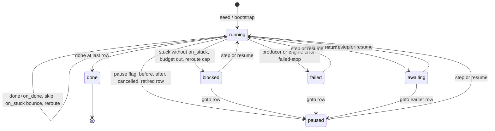

# Map of the state lym keeps for a hub and its runs

This report maps every piece of state lym keeps, where it lives, which code writes and reads it, and whether git holds it.
It also lists the steps `lym adopt` takes today, the adopt failures on record and a first draft of one state machine for a run.
It is the groundwork for the Motif `adopt-redesign`; it names facts and sources and proposes no design.

## Method and limits

- Read-only: the code at commit `588ae6c5` of the branch `lym-state-map`, and the real files on the machine `neve`, read on 2026-11-15.
  No adopt, run or test was started.
- Paths under `internal/` are relative to the code repository root.
  `hub` is `/home/knatte/Code/loomyard-LYMHUB`; `B` is the Bolt hub-scratch directory `hub/_bolt/.lym`.
- "Git holds it" means a commit on a branch of the code repository `Knatte18/loomyard` or the weft repository `Knatte18/loomyard-weft`.
- A claim marked UNVERIFIED rests on a call site, a doc comment or a commit title, not on a read of the code or a run.
  The marks are collected in section 8.
- The machine has no `machine.json`, so its name comes from the hostname rule (`neve`).
  Other machines were not inspected; "on another machine" means what the code does when it finds the item absent.

## 1. Where state lives

### 1.1 Repositories and worktrees

The hub directory `hub/` is not a git repository.
Two GitHub repositories hold all tracked state:

| Repo | Worktree in the hub | Branch | Holds |
|---|---|---|---|
| code `Knatte18/loomyard` | prime `loomyard` | `main` | source only |
| code | each pair `<slug>` | `<slug>` | source only |
| weft `Knatte18/loomyard-weft` | prime weft `loomyard-weft` | `main-weft` | the prime's `_lym` (config and every run record of the prime), `.lym-anchor` |
| weft | each pair weft `<slug>-weft` | `<slug>-weft` | the pair's `_lym` and `.lym-anchor` |
| weft | Bolt `_bolt` | `main` | the board, Sketches, raddle store, hub config, stencils, specs, heddle store, `.lym-warp`, `.lym-shortname` |

Sources: `git -C <dir> status -sb` per worktree; `internal/fabricengine/clone.go:4-5`, `weftbranch.go`, `internal/weftname/weftname.go:12`.
All of the pairs and the prime are linked worktrees of one code repository; Bolt and every weft are linked worktrees of one weft repository.
On this machine every worktree listed was in sync with its `origin` branch at read time, except pairs with a run in flight,
for example `discussed-body-edits-lost-weft` was ahead 3 and its code branch ahead 5.

### 1.2 The `_lym` and `.lym` split

- In each code worktree, `_lym`, `.lym` and `.scratch` are symlinks (junctions on Windows) into the paired weft worktree:
  `lym-state-map/_lym -> lym-state-map-weft/_lym`, `.lym -> .../.lym`, `.scratch -> .../.lym/scratch`.
  Writers: `internal/fabricengine/junction.go` `WireJunctionsWith` `:84`, `scratchlink.go`; primitive `internal/fslink/fslink.go`.
- `_lym` is tracked, in the weft repository; `.lym` is never tracked.
  The split is structural: `structuralCommittedDirs` and `structuralNeverCommittedDirs` at `internal/fabricengine/junctionnames.go:26`.
  Rule text: `pattern/PATTERN-lym-files.md`; a review holds the rule that nothing a run depends on lives only under `.lym`, no test does.
- The links are hidden from the code repository by `/_lym`, `/.lym`, `/.scratch` in the shared `loomyard/.git/info/exclude`
  (`internal/fabricengine/gitexclude.go`, `warpexclude.go`).
  The weft repository hides `.lym/`, `.weft/` and lock names in `loomyard-weft/.git/info/exclude` (`recordsgit.go` `seedWeftArtifactExcludes`); it has no `.gitignore`.
- Bolt's `.lym` is a real directory, not a link (`junctionnames.go:184` `HubScratchDir`); it is the hub-wide, machine-local scratch `B`.
- The tracked contents of one pair weft worktree on this machine: `.lym-anchor`, `_lym/config/*`, `_lym/discussion/*`,
  `_lym/fabric/origin.json`, `_lym/shed/<slug>/{seed.json,status.json}`, `_lym/usage/*`
  (`git -C lym-state-map-weft ls-files`); other pairs add `_lym/landing/summary.md`, `_lym/reviews/code/*`.

### 1.3 How a tracked change reaches GitHub

| Mechanism | What it pushes | Code |
|---|---|---|
| Status commit seam, then a detached push child | a pair's `_lym` on every shed transition; a failed spawn only warns, the next transition carries the commits | `internal/statuscommit/statuscommit.go`; `internal/loomcli/wiring.go:195-228,313`; `internal/fabricengine/spawn.go:148` `SpawnStatusPush` |
| `lym fabric commit`, `lym loom commit-records` | the same, on demand; `PushPairAnchored` is synchronous | `internal/fabriccli/weft_verbs.go:386`; `internal/loomcli/commitrecords.go:34-75`; `internal/fabricengine/pushanchored.go:148` |
| A rejected push | recorded, never forced: `B/failed-push/<side>__<branch>.json` | `internal/fabricengine/failedpush.go:144-152` |
| A pause covering the push | the push child exits and leaves flags under `.weft/` | `internal/fabricengine/pendingflags.go` `pushDeferral` |
| Board write | detached `lym board sync` commits `board sync` and pushes Bolt `main` | `internal/boardengine/board.go:83,197`; `spawn.go:39`; `sync.go:72`; `internal/fabricengine/bolt.go:141,150` |
| `boardengine.SetOwners`, `lym config` | synchronous Bolt pull, commit, push | `internal/boardengine/ownerset.go:129-150`; `internal/configcli/hubwide.go:163` |

Every push is best effort.
A pair's weft branch may hold unpushed commits; they exist on one machine until a later push succeeds.
Whether a pair's weft branch sits unpushed for long was not measured.

## 2. Inventory of tracked state

Each row: what it is, place, writer, reader, push.
All rows are held by git on the branch named in the section.

### 2.1 Bolt, weft branch `main`

| State | Place in `_bolt` | Writer | Reader |
|---|---|---|---|
| Board: entries, `status`, `recipe`, `profile`, `depends_on`, `run_settings`, `owner_machine`, `prime_owner` | `board.json` | `internal/boardengine/store.go:307` `Save` under `board.lock`; status by `board.go:221` `SetRunStatus`; owners only by `ownerset.go` `SetOwners` | `Store.Load`, `owners.go`, dobby, batten, adopt, `pairteardown/claim.go` |
| Rendered board | `README.md`, `project-*.md`, `design-*.md` | `boardengine/render.go` | people, agents |
| Sketch (decision record) of an entry | `decision-<slug>.md` | `boardengine/decision.go:47` | Record-Write `ReadStored` |
| Raddle store per filed Sketch | `raddle/<slug>/*` | `boardengine/raddlestore.go`, `raddlefile.go` | raddle rows |
| Hub config base layer | `_lym/config/<module>.yaml` | `lym config` (`configcli/hubwide.go:163,243`), `hubreconcile/walk.go:275` | `configengine` |
| Hub stencils and specs, orch rules | `_lym/stencils`, `_lym/specs`, `_lym/orch/rules.md` | UNVERIFIED (`fabricengine/stencilcommit.go`) | `stencilstore` |
| Heddle store, overview | `heddle.json`, `HEDDLE.md` | `heddleengine` | heddle render |
| Code repository URL | `.lym-warp` | `fabricengine/clone.go:385`, `reconcile.go:395` | `HubRepoURL`; absent, `lym fabric clone` needs `--warp-url` |
| Hub shortname | `.lym-shortname` | `fabricengine/shortnamebinding.go:20`, `clone.go:395` | `hubgeom/hubgeom.go:105`; creel refuses without it |

Bolt is pushed by the board sync and the synchronous writers of section 1.3.
Not tracked in Bolt: `.board-rendered.json` (rebuilt by `Board.Rerender`), lock files, `.lym/`.

### 2.2 Pair weft branch `<slug>-weft`, prime weft branch `main-weft`

| State | Place under `_lym` | Writer | Reader |
|---|---|---|---|
| Run identity: recipe, driver, params, `started_at` | `shed/<run>/seed.json` | `shedrun.WriteSeed` `internal/shedrun/seed.go:174` | `ReadSeed`; `hubgeom/spawnorder.go` |
| Phase machine: `current_producer`, `state`, `error`, `pause_*`, `history[]` with `machine` | `shed/<run>/status.json` | `shedengine` only (`run.go:909`, `goto.go`, `failedstop.go:79`); `shedverbs/pause.go:117` sets the `pause_*` flags | shed, batten, dobby `BuildView`, `pairteardown/claim.go` |
| Batten child recipe | `shed/<run>/child-recipe` | `shedrun.WriteChildRecipe` `childrecipe.go:36` | `ReadChildRecipe` |
| Dobby notice keys already sent | `shed/<run>/notice-episode` | `dobbyengine/runnotice.go:580` | same |
| Driver stop envelopes, arbiter and tackler attempts, settle log | `shed/<run>/{drive-reports,arbiter,tackler,go-settle.jsonl}` | `sheddriver/recordjson.go:23`, `drive.go:658`, `loomcli/arbiter*.go`, `sheddriver/tackler.go:250` | sheddriver, batten notices |
| Writer stop markers | `shed/<run>/{stop-marker,condition-stop-marker}` | the run's writer agent | the producer; not in the status pathspec (UNVERIFIED whether it shows as residue) |
| Decision record (Sketch copy) and support log | `discussion/{decision-record.md,support-log.md}` | Record-Write `loomshed/recordwrite.go:155,169`; `loomcli/decision.go:1493` (`decision add`, `replace`) | planner, reviewers, darn |
| Plan | `plan/*` (+ `webster/`) | `loomshed/planwrite.go` | webster, validators |
| Plan amendment | `loom/amendment.yaml` | `loomshed/amendment.go:59` | run routing |
| Review rounds | `reviews/<segment>/*` | burler rows, `loomshed/generation.go` | fixers, gates |
| Friction notes | `loom/friction/*` | `internal/friction/friction.go:138`, `loomcli/halt.go:76` | Friction-Reflect |
| Landing description | `landing/summary.md` | the landing-description agent through a shuttle output file | Finalize, PR body |
| Beam ready and landing records | `landing/beam-ready.json`, `landing/beam-landing.json` | `beamcli/deps.go:200,286`, `pawlengine/landing.go:62,83` | pawl, dobby |
| Project record of a beam | `loom/project/<beam>/*` | only `lym loom decision add|replace` (`PATTERN-run-records`) | members |
| Drift records | `drift/{scope.json,judged.json,expected.yaml,judgement.yaml,logs/}` | `driftengine/records.go:284,302`, `expect.go:412` | drift rows |
| Usage records | `usage/{run.json,landed.json,session-<id>.json}` | `shedrun/usage.go:68-114` | cost report |
| Webster state, outcome, reports | `webster/{state.json,outcome.yaml,reports/}` | `websterengine/state.go:389` | webster; the session ids in it resolve only on the machine holding the transcript |
| Raddle run files | `raddle/*` | `loomshed/raddlestate.go`, `loomcli/raddleverbs.go:217` | raddle rows |
| Pair origin record: parent branch, parent worktree, beam flag | `fabric/origin.json` | `fabricengine/origin.go:143` `WriteOrigin`, once by `Topology.Add` | `hubgeom/parent.go`, `parentof.go`, `nearestlive.go` |
| Worktree config layer, markers | `config/{<module>.yaml,sparse}` | `lym config`, `hubreconcile/walk.go:378` | `configengine` |
| Anchor subpath marker | `.lym-anchor` at the weft root | `fabricengine/anchormarker.go:74` | `lymcwd/anchor.go` `readRecordedAnchor` |

The prime's runs (batten) are recorded the same way in the prime weft's `_lym/shed/<slug>/`
(`seed.json` has `"recipe": "batten"`, `"driver": "go"`).
Where `_lym/landing`, `_lym/drift` and `_lym/raddle` are committed was not traced (UNVERIFIED).
Tracked and still machine-bound: step envelopes and `status.json` `output` fields carry absolute paths of the machine that wrote them
(`/home/knatte/...` seen in history entries); `_lym/webster/state.json` carries Claude session ids.

## 3. Inventory of state git does not hold

### 3.1 In each worktree's `.lym` (inside the pair's weft worktree)

| State | File | Writer | If another machine lacks it |
|---|---|---|---|
| Shed run scratch: locks, `steps/<trace>.json`, loop pid and log | `shed/<slug>/` | `shedrun/paths.go:35-76`, `shedverbs/steprecord.go:79`, `looppid.go` | step history is lost; a pid file names a process on the old machine, so a loop there reads as not live |
| Pull-request record: number, URL, head, `gated_head`, `mailed_head`, review strand and session ids, `continue`, `closed_for_continue` | `shed/<slug>/pull-request.json` | `internal/pullrequest/record.go:57,64` | with no record Finalize marks the landing to open a pull request (`landingshed/finalize_pr.go:157`); a duplicate is possible, whether GitHub is searched first is UNVERIFIED; no rebuild |
| Merge record of Parent-Align | `shed/<slug>/merge-record.yaml` | `landingshed/mergerecord.go:3` ("never committed") | the fixer re-reads |
| Fixer attempt counters | `shed/<slug>/<row>-fixer-attempts.json` | `landingshed/fixerattempts.go:48,78` | the attempt cap resets |
| Batten per-row marks: `-spawned`, `-halt-warned`, `-revived`, `-decision-acted`, `-done-seen`, `-stuck.md`, `-memory.json`, `-notice-episode`, `abandoned-session` | `shed/<slug>/` | `battenshed/innerrun.go:49-95,896-1217`, `stuck.go:32`, `notice.go:495`, `teardown.go:45` | notices, spawn confirmations and revives can repeat; only the sent-notice keys are not derivable from `status.json` |
| Driver park marker and resume report | `shed/<slug>/{driver-parked,driver-resume-report}` | `loomcli/commitrecords.go:92`, `driverresume.go:54` | the park marker resumes a driver by typing into a local tmux pane |
| Origin-owed marker | `shed/<slug>/origin-owed.json` | `battencli/resumereconcile.go:72` | a resume judged its owner without reaching origin |
| Cancel marker and lock | `shed/<slug>.cancel.json` | `battencli/cancelmarker.go:156` | another machine does not see an interrupted cancel |
| Hub-scoped run and land locks | `shed/{run.lock,land.lock}` | `shedrun/paths.go:551,557` | serialise one machine only |
| Gate green record, redundancy report, detach runs | `gate/{green.json,redundancy.json,detach/}` | `gatecli/green.go:33`, `redundancyreport.go:21`, `detachrun.go:31` | tiers rerun; "unreadable or malformed reads as empty" |
| Verify records | `verify/{running.yaml,verified-tree.yaml}` | `verifytree/verify.go:32-33` | the verify command reruns |
| Shuttle run dir: `run.json` (run id, strand guid, session id, output files, absolute paths), `prompt.md`, `settings.json`, `events.jsonl`, `sent-texts.jsonl` | `shuttle/<runId>/` | `shuttleengine/rundir.go:73,93-153,199`, `carryover.go:22-47` | `ErrNoRunRecord`: a strand cannot be reattached; typed operator instructions are not carried over (`carryover.go:130,173`) |
| Reed state: socket, session, strands with guid, name, absolute worktree and `lymBin`, pane id | `reed.json` (+ locks), `reed/launch/*.sh` | `reedengine/state.go:122,149`, `panebin.go:303` | no strands; nothing rebuilds them from pushed state, a run start or `lym reed add` recreates them |
| Loom scratch: status strand, handoff voucher, driver log, rework coverage | `loom/*` | `loomcli/statusbuild.go:12`, `entryobservation.go:45` | a resume leaves a crash-resume note when the voucher is missing |
| Dobby state: pid, `sleeps[]`, per-run `last_pass_exit`, notice memory, `starts`, `counted_landings`, `land_notices`, `landed_since_tidy` | `beam/state.json` | `dobbyengine/state.go:124,138` | an undecodable record reads as absent; landing counts rebuild only through `LandingsBaselined` from pushed `_lym/shed/*`, `LandedSinceTidy` and `LandNotices` do not |
| Dobby liveness lock, log, land request, pawl markers, tidy memory | `beam/{dobby.lock,dobby.log,land-request.json,dobby-stop,await-entered,handoff-sent,tidy/}` | `dobbyengine/geometry.go:17-24`, `pawlengine/landrequest.go:18-54` | per machine |
| Orch routing state | `orch/state.json`, `orch/watch.log` | `orchroute/paths.go:14,22`, `orchcli/status.go:78` | per machine |
| Local config layer | `config/<module>.local.yaml` | `lym config --layer local` | the override is absent, lower layers apply |
| Heddle render record | `heddle/{render.lock,claude-settings.rendered.json}` | `heddleengine/render.go:80`, `settings.go:248` | the next render cannot remove retired keys (UNVERIFIED) |
| Trace logs | `logs/trace-*.log` | `internal/logger/sink.go:22-32` | history lost |
| Scratch | `scratch/` (the `.scratch` link target) | agents | agent notes are lost |
| Per-file locks of `_lym` files | `locks/_lym/**` | `lock/tracked.go:29` | none |

### 3.2 In Bolt's `.lym` (hub scratch `B`, shared by every worktree of the hub on this machine)

| State | File | Writer | If another machine lacks it |
|---|---|---|---|
| Pause record: `live[]`, `resumed[]` entries with scope, caller (`owner`, `adopt`, `adopt-hold`, tender), sessions | `pause/record.json`, `pause/net/`, `pause/waiting/` | only `pauserecord.Update` `internal/pauserecord/record.go:125`; callers `tenderengine/pause.go`, `resume.go`, adopt, dobby, hibernate | a missing file reads as the empty record, so that machine's runs are not paused; adopt writes its own entries on the adopting machine |
| Parent lock: branch, owner `{run, pair, pid, start}`, tickets | `parent-lock/<hex branch>.{json,lock,tickets/}` | `parentlock/store.go:35,135,143` | valid only while the owner process lives; a copied record reads as stale |
| Run process registry `{pid, pgid, start_time, role, argv}` | `runproc/<owner>/<pid>-<start>.json` | `runproc/record.go:106`; roles listed at `:24-46` | meaningless elsewhere, pruned when the pid is gone |
| Gate slot pool: locks, holder records, prebuilt binaries, run logs | `gate/{slot-N.lock,slot-N.yaml,prebuilt/,runs/}` | `gateslot/pool.go:49-118`, `runlog.go:21` | per machine |
| Coverage maps | `testcover/<pkg tree>/map.json`, `testmap-exit.json` | `lym gate testmap` (`testcover/coveragemap.go:16,27`) | gate scope selection runs without them; a design to move them into the weft is on the board (`_bolt/design-testmap-maps-in-weft.md`, not read) |
| Failed-push records | `failed-push/<side>__<branch>.json` | `fabricengine/failedpush.go:144-152` | recreated at the next rejection |
| Teardown locks, log archive (30-day retention) | `teardown/<slug>.lock`, `log-archive/<stamp>/` | `fabricengine/teardownlock.go:20`, `pairteardown/archive.go:20` | per machine |
| Adopt record, output, check records | `adopt/{adopt.json,adopt.out,root/,<subject>/{check.json,fix-tries.json,...}}` | `adoptrecord/record.go` (worker only), `adoptcli/check.go:103-141` | another machine cannot see an unfinished adopt on this one |
| Front-task records | `fronttask/records.json` | `internal/fronttask` | the dobby front-task rule |
| Hibernate request and watch log | `hibernate/{request.json,watch.log}` | `internal/hibernateengine` | per machine |
| Creel: journal (mail, injects, holds), unread flags, daemon lock and log | `creel/{journal/YYYY-MM-DD.jsonl,flags/,daemon.lock,daemon.log}` | the daemon only: `creelengine/journal.go:315`, `flags.go:46-76`, `server.go:74` | mailboxes start empty; unread mail, queued injects and holds are lost; flags rebuild from the journal (`flags.go:64`); no code rebuilds the journal |
| Slack: channel map, forwarding, outbox, relay | `slack/*` | `slackengine/geometry.go:22-38`, `hubgeom/slackgeom.go:53-69` | a new machine makes its own channels (names carry the machine name) |
| Machine config layer | `config/<module>.machine.yaml` | `lym config --layer machine` | lower layers apply |
| Config build stamp, reconcile lock | `config/{build-stamp.json,reconcile.lock}` | `hubreconcile/hubreconcile.go:28,33` | the walk reruns once |
| Hub locks | `locks/*`, `hub-workspace.lock`, `reed-watchdog.lock`, `testmap-upkeep.lock` | `fabricengine/hubworkspace.go:28`, `reedcli/watchdog.go:708`, `gatecli/testmap.go:53` | harmless |
| Tmux and watchdog logs, discover signal | `logs/tmux-*.log`, `reed-discover.signal` | `reedengine/lifecycle.go:130-172`, `reedengine/watchdog.go:34` | recreated |

Within the weft worktrees' git directory: `fabric-corrindex.json`, rebuilt from `Warp-SHA` trailers (`fabricengine/index.go:25,60`).

### 3.3 Outside the hub

| State | Place | Writer | If another machine lacks it |
|---|---|---|---|
| Claude session transcripts, forks | `~/.claude/projects/<worktree path, non-alphanumerics as "-">/<id>.jsonl` | Claude Code; lym reads (`claudeengine/audit.go:100-107`, `transcriptread.go:31-48`) | keyed by the absolute worktree path: a resume needs the transcript (`claudeengine/resume.go:53-55`); usage already copied into tracked `_lym/usage/session-<id>.json` stays |
| Claude live-session registry | `~/.claude/sessions/<pid>.json` | Claude Code; lym reads (`claudeengine/resume.go:38,99-121`, `prober.go:35`) | liveness reads unproven |
| Installed plugins | `~/.claude/plugins/installed_plugins.json` | Claude Code | session scope resolves against the local install |
| Plugin cache mirror | `~/.claude/plugins/cache/...` | `tools/deploy/main.go:230-262` | rebuilt by `update-plugins.sh`; the deploy skips a plugin not installed |
| Rendered instruction files `CLAUDE.local.md`, `AGENTS.override.md`, `.claude/settings.local.json` in each worktree | the worktree | `heddleengine/target.go:24,64,65` | rebuilt from the tracked `heddle.json` by `lym heddle render` (which verbs call it was not traced) |
| Codex home: `config.toml`, `lym-trust.json`, links into `~/.codex` | `~/.lym/codex/` | `codexengine/home.go:28-156` | rebuilt at each launch; the login in `~/.codex` is the operator's |
| Tmux server socket per hub and sessions, panes, window names, wait marks, check marks, `@lym_*` options, button row | `/tmp/tmux-<uid>/lym-<hub base>-<hash8>`, tmux memory | `reedengine/server.go`, `socketfile.go:122-139`, `doc.go:44-64`, `hubgeom/buttons.go:220-315` | the hash covers the absolute hub path; display state dies with the pane and rebuilds at boot or attach |
| Creel daemon socket | `/tmp/lym-<uid>/creel-<shortname>-<hash8>.sock` | `creelengine/server.go:98` | recreated at daemon start |
| lym temp root, per-process run dirs with `run.lock` | `/tmp/lym-<uid>/r<4>/` | `lymtemp/root.go:74-91`, `run.go:161-183`, `sweep.go` | self-cleaning |
| Machine name `machine.json` `{name, names[]}` (absent here) | `~/.config/lym/` | `machinecli/set.go:120-138` | without it the name is the lowercased short hostname (`machinename.go:115-168`); the former names in `names` are lost |
| GitHub token cache | `~/.config/lym/credentials.json` | `githubclient/cache.go:24-60` | a miss falls back to `gh auth token` |
| Slack tokens, socket lock, presence | `~/.config/lym/{slack.json,slack-socket.lock,slack-presence.json}` | `slackengine/geometry.go:17-21`, `slackcli/cli.go:666,711` | the bridge cannot start without the tokens |
| Hub registry `{hub_path, shortname, recorded_at}` | `~/.local/state/lym/hubs.json` | `creelengine/hubs.go:84`, `hubregistry/hubregistry.go:55` | each hub re-records itself at daemon start |
| Standalone reed state per target path | `~/.local/state/lym/<hash8>/` | `standalonestate/standalonestate.go:410-423` | per absolute path |
| Production binary | `$GOBIN` or `$GOPATH/bin` | `tools/deploy/main.go` | built per machine; no pointer on origin records the deployed commit (`main.go:11-12`) |

Other machine-local files: the hub workspace `loomyard.code-workspace` and `<repo>-<beam>.code-workspace`
(`fabricengine/hubworkspace.go`, regenerated from worktrees, origin records and settings, so rebuildable from pushed state);
the retired `hub/_launchers/` (no verb writes it, `retiredlaunchers.go:2`; `lym cleanup` sweeps it).

## 4. Steps `lym adopt` takes today

Adopt never contacts the old owner.
It reads origin (Bolt, the code and records branches, tags) and local files, then writes the owner into Bolt and pushes it.
The old owner learns of the takeover from Bolt (section 4.3).
Sources are under `internal/adoptcli` unless named; the full step-by-condition table is in 4.2.

### 4.1 Call, worker and the eight steps

Before any step:
- The call `runAdopt` (`caller.go:112-184`) exempts its own process from a pause (`SetGateExemptAll`), validates, judges the standing record, and spawns a detached worker `lym adopt worker` whose output goes to `adopt.out`.
  Children install their own gate, which a pause still holds.
- `--here` (behind `lym s`) pulls Bolt and runs `lym adopt <subject>` when the worktree's entry is owned elsewhere (`here.go:29-89`).
- The worker takes `adopt.lock` non-blocking, reads the record, decides fresh, follow, resume or refuse, and writes `adopt.json` `running` (`worker.go:185-292`).
- `refuseBeforeSteps` refuses an anchor change standing in the prime, a parent worktree or an adopted slug's own worktree (`steprun.go:182-192`, `refusal.go:20-51`).

The step order is `adoptrecord.Steps` (`adoptrecord/record.go:41`):

| # | Step | What it does | Reads | Writes | Git |
|---|---|---|---|---|---|
| 1 | `reconcile` (`steps.go:23-94`) | a moving, hub-scope origin reconcile; splits runs that keep another owner; decides which projects a stop holds back | local branch tips, tracking refs, reflogs, batten status files, pause record, live strands and locks; origin heads and Bolt's run ledger (`originreconcile.go:673-756,966-993`) | branch fast-forwards, replays of local commits onto origin, teardown of local pairs of runs origin ended, `Inputs` in `adopt.json` | `ls-remote` of the code and records repositories (20 s, one attempt), `fetch` of moved branches, `merge --ff-only`, replays; no push, no reset, no rebase (`originreconcile.go:525-578,775-779`) |
| 2 | `pairs` (`steps.go:98-133`, `adopt.go:413-460`) | per slug: stop, drop local commits, or add the missing pair | reconcile report, local pair, live pair, owners | `topology.Add` (a code and a records worktree, junctions, origin record); with `--drop-local` a local tag `archive/<slug>/<tip>`, removal of untracked files that origin tracks, `reset --keep` (`destroy.go:2007`) | origin probes, `fetch`, `git worktree add --track`; a leftover local branch refuses the add (`add.go:339-341`) |
| 3 | `pause` (`steps.go:139-185`, `pause.go:21-140`) | writes an `AdoptCaller` entry for each moved run, live pair and released task; converts an `OwnerCaller` entry in place | owners, tasks, pause record | the hub pause record, `Inputs.Paused`; no grace, no Esc | none |
| 4 | `owner` (`steps.go:190-242`) | `boardengine.SetOwners` with `Takeover: true` for the adopted beams and the prime | local Bolt | `owner_machine` and `prime_owner` in `board.json`, one commit `board: owner <machine> for <slugs>`; `Inputs.OwnerStood`, `PrimeRecorded` | Bolt `fetch`, ff or replay, commit, push, replay and push again on rejection; a held lock defers the push, one retry after 1 s (`ownerset.go:129-150,303-324`) |
| 5 | `deploy` (`steps.go:246-259`, `deploy.go:52-164`) | only when the prime's owner was written: runs the hub's `deploy` command in the prime | `landing` config, VCS stamp of the running binary, prime branch and head | `deploy.log`, whatever the command installs | local reads only; the command's own network use |
| 6 | `beam` (`steps.go:263-278`, `adopt.go:565-595`) | `orchcli.BeamUp` for the prime and each beam in `OwnerStood`: dobby, relay, reed session, runs strand, the orch unless `--no-orch`; no hub reconcile | owners, worktree beam facts, the task entry | tmux and process state, the start lock, dobby files | not in adopt's code; the dobby pulls Bolt itself at most every 5 minutes (`dobbyengine/handover.go:17-32`) |
| 7 | `check` (`steps.go:284-312`, `check.go:152-296`) | per subject spawns a detached `lym adopt check` that runs the hub's `adopt` gate; a green end removes the fix task, a failed end files a darn fix task through `fronttask` | `check.json`, gate config, local Bolt owner | `fix-tries.json`, `check.out`, `check.json`, `suite.log` | the verb runs `hubreconcile.Ensure` first, which pulls the board; filing a fix task writes the board |
| 8 | `done` (`steps.go:318-329`) | stops the record `stopped` when a project was held back; otherwise `done` | the record | `adopt.json` `done` plus the envelope | none |

A beam failure is a warning, not a stop; the check is advisory and blocks neither the owner write nor the pause.
The pause written in step 3 stands until an operator lifts it with `lym tender resume` or `lym batten cancel`.

### 4.2 Which steps can fail

"stops" ends the record `stopped` at that step; a re-run resumes.
Columns: (a) the old owner's machine is off, (b) the old owner holds unpushed commits or uncommitted files, (c) a lock is held, (d) the network is down.

| Step | (a) | (b) | (c) | (d) |
|---|---|---|---|---|
| `--here` pull | no effect | invisible to adopt | blocks on the Bolt write or push lock (wait length UNVERIFIED) | skipped with a warning; local Bolt may be stale, so `owned_here` can be wrong |
| worker start | no effect | no effect | `adopt.lock` held: error, nothing written | no effect |
| `reconcile` | no effect: origin only | no effect on adopt; this machine's own local state: project held back whole unless `--keep-local`, dirty Bolt or prime records branch stops | prime lock or parent lock held reads `busy`; a `busy` Bolt or prime records branch stops; a records push lock is waited up to 30 s | stops: `ls-remote` transport failure, no retry; any other fetch error stops |
| `pairs` | no effect | `--drop-local` tags and resets local tips; a leftover local branch refuses the add | the slug's teardown lock held fails the add for that slug (mode UNVERIFIED) | per slug the probes and fetches fail and the project is held |
| `pause` | no effect | no effect | waits on the record's state lock (length UNVERIFIED) | no effect |
| `owner` | no effect: the write needs no help from it | no effect | a held lock defers the push; one retry, then stops | stops with `ErrOwnerOriginUnreachable`; the commit stays local, so local Bolt names this machine owner and origin does not (effect on other local readers UNVERIFIED); the pause stays |
| `deploy` | no effect | no effect | none taken | the hub's command may fail and stops the record |
| `beam` | no effect | no effect | blocking start lock | warning only |
| `check` | no effect | no effect | `check.lock` held returns at once; `reconcile.lock` times out after 2 min and the check ends `failed` | a failing board pull ends the check `failed` before any tier |
| `done` | no effect | stops when a project was held back | no effect | no effect |

### 4.3 The old owner's side

- The old owner's dobby pulls Bolt on a probe tick, at most every 5 minutes (`dobbyengine/handover.go:17-32`).
  When it reads another owner, it owner-pauses its runs, archives, and exits once the archive succeeds (`handover.go:65-90`).
  `lym beam start` on that worktree refuses a worktree another machine owns and runs the same archive (`orchcli/start.go:507,541-551`).
  Neither runs while an adopt in flight on that machine covers the worktree (`handover.go:38-47`).
- The archive (`fabricengine/ownerarchive.go:49-144`, `beamcli/ownerarchive.go:23-80`): per pair and side, when the local tip is not in origin's head,
  create the tag `archive-owner/<slug>/<sha12>` and push the tag; no branch is pushed.
  It archives commits only; uncommitted files are never archived.
  A teardown lock held past 30 s is `ErrPairPushRunning`; the dobby retries at the next tick.
- With the old owner's machine off, none of this happens: no archive tag exists, and its unpushed commits are visible to nobody.
- `lym adopt --archives` lists tags whose commit the slug's origin branch does not contain (`archives.go:50-98`).

### 4.4 Owner rules adopt touches

- `owner_machine` is recorded on a beam project and `prime_owner` at the board's top level; `boardengine.SetOwners` is the only writer (`boardengine/doc.go:175`).
  Only `lym adopt` passes `Takeover`.
  Other callers: `lym beam create` (`beamcli/create.go:163,181`), the `lym machine name` sweep (`machinecli/set.go:197`),
  the dobby and orch start claim of the prime (`hubgeom/dobbygeom.go:108-112`, `orchcli/ownerpause.go:125-150`).
- The effective owner is the recorded one for a beam project, else the parent's; `OwnedElsewhere(owner, here)` is `owner != "" && owner != here`
  (`boardengine/owners.go:132-177`).
  The parent comes only through `hubgeom.ParentOf` (`hubgeom/parentof.go`), from the pair's origin record.
- This machine's name comes only from `internal/machinename`; owner records are only as stable as that name.
- The verdict that gates a resume, wake, push or landing is judged against origin inside `ReconcileOrigin` (`PATTERN-owner-machine`).

## 5. Adopt failures on record

Records read: `B/adopt/{adopt.json,adopt.out,check.json,check.out,root/}`, `B/hibernate/watch.log`, `hub/loomyard-weft/.lym/orch/watch.log`,
the board entries `adopt-redesign` (T4), `adopt-revision` (P1), `pause-holds-operator-verbs` (T10), and `git log --all --grep=adopt`.
`adopt.out` holds eighteen lines, mostly JSON envelopes with no timestamp; the dates come from WARN lines and commit times.
No board note titled `Decision for` concerns adopt; no note or task carries adopt error text.
`lym logs` does not exist; Bolt has no tender log directory.

- The latest adopt record is of `lym adopt root`, started 2026-11-15T12:26:55, state `done`, with no error and no warning;
  the root check is green (tier 0: 27788 passed, 0 failed, 1009 skipped; tier 1: 4286 passed, 0 failed; tier 2: 280 passed, 0 failed).
  `suite.log` of both checks has no `--- FAIL`, `FAIL` or `panic:` line.
  The T4 body says no error text was recorded and the last adopt was 2026-11-11 14:37; `adopt.out` holds error text and the record is from 2026-11-15.
- The adopts the operator remembers as failing on 2026-11-12 and 2026-11-15 left no failure record: the only 2026-11-15 record is a success.

| # | Date | What failed | Error text | Source | Status |
|---|---|---|---|---|---|
| A1 | 2026-11-11 | an adopt held at its first call by a hub-wide pause | `lym: held by a hub-wide pause since 2026-11-11T10:34:58+01:00; it continues after "lym tender resume"` | `adopt.out:1` | `6f8d4cff` "pass pauses" (UNVERIFIED as the trigger); the same hold on `lym s` is T10, running |
| A2 | 2026-11-11 | origin reconcile stopped on a busy weft push lock, while the envelope lists mutations that ran | `lym adopt: the origin reconcile stopped, so nothing ran; main-weft (busy): wait for the holder of the weft push lock to end` | `adopt.out:2` | the message says "nothing ran" beside non-empty `mutations`, open; `6f8d4cff` "wait on push locks" |
| A3 | 2026-11-11 | `root` held back by a stop on local commits origin lacks or a live pair; three runs stayed owned by `osl-1046` | `lym adopt: root held back by a stop on local commits origin lacks or on a live pair, so its owner stays; ...--keep-local... --drop-local...` | `adopt.out:3-4` | the operator chose a flag; the cause is T4's "a machine cannot know what another machine holds" |
| A4 | 2026-11-11 | `--drop-local` could not move a weft branch | `... git reset --keep 22cc88...: exit 128: error: Untracked working tree file '_lym/reviews/code/generation-record.json' would be overwritten by merge.` | `adopt.out:5` | probably fixed by `6f8d4cff` "clear lym files" (UNVERIFIED) |
| A5 | 2026-11-11 | seven more adopts of `root` refused with the A3 text, now naming `--no-orch` | as A3 | `adopt.out:6-12` | ended by the success at 14:37; no cause per retry |
| A6 | 2026-11-11 14:37 | the orch was not resumed and came up fresh | `orch: the recorded session could not be resumed; launching fresh` ... `session 3900dbf3-... is held by live process 3164987 ...; exit that session first, then resume`; carry-over of 191 instructions | `adopt.out:13-15` | open |
| A7 | 2026-11-15 12:27 | the same on the move back to `neve` | `... session e7be957b-... is held by live process 3463757 ...`; 354 instructions | `adopt.out:16-18` | open; the adopt itself ended `done` |
| A8 | 2026-11-15 | the orch watcher on `neve` exited, owner named by two spellings | `{"watcher_exit":"owned by machine osl46"}`; earlier lines `owned by machine osl-1046` | `loomyard-weft/.lym/orch/watch.log:8,20-22` | open; cause of the two spellings UNVERIFIED |
| A9 | 2026-11-11 | `lym s` held by a run-scoped pause after an owner-only check | `lym: held by the pause of <slug> since <time>; it continues after "lym tender resume"...` | T10 body | open on main; T10 running |
| A10 | 2026-11-02 | hibernate wake notice not delivered | `creel: unknown receiver "ly:orch"; the names that exist: ly:BATTEN, ly:DOBBY, ...` | `B/hibernate/watch.log:1` | UNVERIFIED |
| A11 | 2026-11-02 | wake notice over the hook limit | `the message's line is 105596 bytes, over the 8192-byte limit one hook delivery carries`; the text names an origin reconcile stop on changed paths of `origin/main-weft` | `watch.log:2` | `44ca77de` "keep notices short" (UNVERIFIED) |
| A12 | 2026-11-11 | reconcile could not remove a finished run's pair | `worktree has uncommitted changes; use --force` (entry `loop-exit-not-recorded`) | `adopt.out:2-3`, later way forward at `:5,:12` | open: a stranded pair |
| A13 | 2026-11-11 | every non-prime run held back whole | `not taken over: another run under `root` stopped, so the adopt holds it back whole` (19 times) | `adopt.out:3-12` | a design rule that lengthens retry chains |
| A14 | 2026-11-15 | pairs left over after benches and a cancelled run: `pwc-opus`, `pwc-fable`, the kept `claude-account-weights`, and `rerun` | no error text; `rerun` fails to respawn on `lym tender resume` | T4 body; `adopt.json` lists three as `level` | open; reconcile sees them as level |

Adopt commits: `0deeb9b9` detached recorded worker, `0198b955` idle adopter and old-owner archive, `89270807` `--here` and `--archives`, `aeea549d` green mark,
`6f8d4cff` pauses, push locks, lym files, rejudge, `90d11895` handover gaps; beam merge-parent is T14.
Since 2026-11-12 no commit names adopt except `79f0eb4a`, a pilot report.

## 6. A first draft of one state machine for a run

### 6.1 Where each module records state

| Module | Record | Fields or states | Writer | In git |
|---|---|---|---|---|
| shed (batten and loom runs) | `_lym/shed/<run>/status.json` | `state` in `running`, `paused`, `done`, `blocked`, `failed`, `awaiting`; `current_producer`, `error`, `transient`, `pause_*`, `history[]` | `shedengine` only (`status.go:18-23`) | yes, committed on every persist |
| batten | the prime's `status.json`, same type | rows `Worktree-Create, Seed-Child, Open-Window, Seed-IDE, Open-IDE, Run-Shed, Land, Worktree-Teardown` (`contracts/recipes/batten-recipe.yaml:41-86`) | `shedengine` over the batten recipe | yes |
| loom | `status.json` in the task worktree | rows of the darn, tapestry, motif, raddle, pawl and sampler recipes (`contracts/recipes/*.yaml`) | `shedengine` over a loom recipe | yes |
| dobby | `.lym/beam/state.json` | per run `last_pass_exit`, `full_pass_owed`, `owned_elsewhere`, `owner_notice_sent`, `operator_wait`; `starts`, `land`, `ready_hold` | `dobbyengine.UpdateState` | no |
| tender | `B/pause/record.json` | entries `{scope, paused_at, grace_end, caller, sessions[], resumed_at}`; callers `owner`, `adopt`, `adopt-hold`, tender | `pauserecord.Update` | no |
| board | `status` in `board.json` | `nil`, `draft`, `done`, `<shed state> · <row>` | `SetRunStatus`, `SetStatus`, `applyDraftRule` (`boardengine/runlock.go:15-52`, `draft.go`) | yes |
| markers | files under `.lym/shed/` | `<slug>.cancel.json`, `driver-parked`, `batten-watched`, `driver.lock`, `origin-owed.json`, `tackler-inflight.json`, `arbiter-inflight.json` | batten, sheddriver, shedrun | no |

### 6.2 Transitions of one shed run

Writer is `shedengine`; sources `internal/shedengine/`.

Anchors: `done` at the last row `run.go:490`; stuck to `blocked` `run.go:439,454`; `awaiting` `run.go:477`; producer error to `failed` `run.go:425`;
pause at a row boundary `run.go:279,292`; `FailedStop` only from `running` `failedstop.go:74-92`; `goto` refuses `done` and `running` `goto.go:99,111`;
`done` ignores `step` `run.go:226`.
`awaiting` spends no bounce budget and re-calls the producer on resume (`status.go:11-16`).
`transient` classes on a `failed` write: `git-transport`, `github-api`, `agent-start`, `host-resources` (`transient.go`).

### 6.3 Layers above the shed run

- Board status: `nil` or `draft`, then `running · Worktree-Create` at a batten claim (`battencli/cli.go:120-127`, `owner.go:206`),
  then `<shed state> · <row>` on every transition (batten rows first, loom rows from `Run-Shed` on, `loomcli/wiring.go:322-355`), then `done` on landing (`loomcli/landingdeps.go:209`).
  Cancel and a refused Sketch write `draft` back (`battencli/cancelcmd.go:515-528`, `loomcli/wiring.go:297`).
  A finished motif-only run writes a Sketch (kind note, label `sketch`, `boardengine/sketch.go:93`).
  A write failure only warns and retries at the next transition, so the board can lag `status.json`.
- Batten treats the child's `blocked`, `paused` and `failed` as halted and `awaiting` apart (`battenshed/innerrun.go:538-547`).
- Dobby drives a run only while batten reads `running`, or `paused` with work on the parent (`dobbyengine/passes.go:71`);
  a pass exits 0, 77 owned elsewhere, 78 covered, 79 continue refused (`passes.go:405-460`, `geometry.go:8-12`).
- Owner: a pass on a machine that is not the owner exits 77; the dobby marks `owned_elsewhere`, writes a pause entry with caller `owner` and posts one notice naming `lym adopt`
  (`owned.go:22-70`); adopt converts it to caller `adopt`, lifted only by hand (`pauserecord/doc.go:21-31`).
- Tender: `pause`, `resume`, `lift` write entries; the run's shed state stays `running` while an entry covers it.
- Pair-level states from the fabric reconcile (`level`, `diverged`, `needs_replay`, `owned_elsewhere`, `ended`, `stopped`, `busy`, `live`) are a third vocabulary, outside these four modules, not drawn.

### 6.4 Where the vocabularies disagree or overlap

1. `paused` is a shed state, a dobby copy of that string (`passes.go:20`), a tender entry's meaning, an overview string (`battencli/overview.go`) and an adopt run report value.
   A run can be shed-`running` while a tender entry covers it.
2. `running` is re-declared as a string in dobby (`passes.go:18`, `runnotice.go:41`) and in `loomcli/checklist.go:44`, not imported from `shedengine`.
3. `blocked`, `failed` and `awaiting` get three handlings: dobby gives them no pass, batten calls the first two halted and `awaiting` apart, the driver parks at all four (`loomcli/start.go:152`, `battencli/drive.go:165-173`).
4. `done` means a shed state, the board status, a batten record whose pair still stands (`dobbyengine/ended.go:32-43`), and a dobby skip.
   A finished run's directory stays, and T14 records that its `done` batten record makes batten refuse the slug.
5. The board composes `<state> · <row>`, so `blocked`, `failed` and `paused` runs stay in the board's Running layer (`boardengine/layer.go:16-81`); the board has no halted layer.
6. Board status has two writers (batten before `Run-Shed`, loom from `Run-Shed` on).
7. Owner state sits in the Bolt owner record, batten's exit 77, dobby `owned_elsewhere`, a pause entry with caller `owner`, and after adopt a pause entry with caller `adopt`;
   the lifters judge only `owner` (`pauserecord/doc.go:25-29`).
8. The durable and ephemeral split follows the directory, not the machine's role:
   cancelling, parked and origin-owed are decisions held only in untracked markers that the committed status does not carry.
   Dobby state, the pause record and the hibernate request are outside the run's committed state.
9. A stop's identity `StopKey{current_producer, history_length, state}` (`sheddriver/stopkey.go:16`) and the file mtime give one stop two clocks.
10. A pair ends through `lym batten cancel`, `lym fabric remove`, `lym cleanup --apply` or the dobby's `tearDownEnded`; none of them go through a shed state.
11. Hibernate is in no module's states: it is a request file and a pause lift on wake (`B/hibernate/request.json`).

## 7. Observations the Motif may need

These are facts the sections above support, with no proposal attached.

- Everything under any `.lym` is machine-local and never pushed.
  Run-relevant state held only there: the pull-request record, the parent lock, the pause record, dobby `state.json`,
  the merge record and fixer counters, shuttle `run.json` and sent texts, the adopt record, the per-row batten marks.
  The rule text says a run depends on nothing that lives only under `.lym`; these seven kinds are counter-examples (`PATTERN-lym-files.md`).
- Tracked state is pushed by detached children after a commit.
  A push can lag or fail with the commit left local, and nothing makes a transition wait for its push.
- A Claude session is resumable only on the machine and path that hold its transcript; the orch fell back to a fresh session on both recorded adopts because a live process held the session.
- Adopt reads only what origin holds; what the old owner holds locally reaches it only through the owner archive, which runs on the old owner after it has pulled Bolt.
- Owner identity is the machine name; a rename or a second spelling reads the owner as another machine.
- Two systems record "paused": the run's own `pause_*` flags in `status.json` and the hub's pause record in `B`.

## 8. Not verified

- The write path of `machine.json` beyond `machinecli/set.go:120-138`, and which verbs call a heddle render.
- Where `_lym/landing`, `_lym/drift` and `_lym/raddle` are committed, and the writers of `design-*`, `project-*`, `.lym/burler`, `.lym/drift-judge` and `.lym/parent-review`.
- Whether `fabricengine/stencilcommit.go` commits the hub stencils; which files each `_bolt/raddle/<slug>/` holds.
- Lock modes and waits: `lockPairTeardown` (`fabricengine/add.go:223`), the Bolt board lock wait, the pause record's update lock.
- The git use of `orchcli.BeamUp`, `fronttask.File` and `Remove`, `hubreconcile.Ensure`, `weftLiveness`; `fixloop.go`, `runreport.go`, `checkview.go` were read through `adoptcli/doc.go` only.
- What local readers do with an owner commit that an `owner` stop left unpushed.
- Whether Finalize searches GitHub for a pull request before it opens one when the local record is gone.
- Whether each fix commit named in section 5 cured its failure: the commit titles were matched, no test was run.
- The cause of `osl46` against `osl-1046`; the dates of envelopes `adopt.out:2-12`.
- Windows junction behaviour; `slack-switch.json`, `cursor.json`, `presence.json` and `/tmp/darn-*.tsv` have no reference in the repository.
- Whether a pair's weft branch sits unpushed for long.
